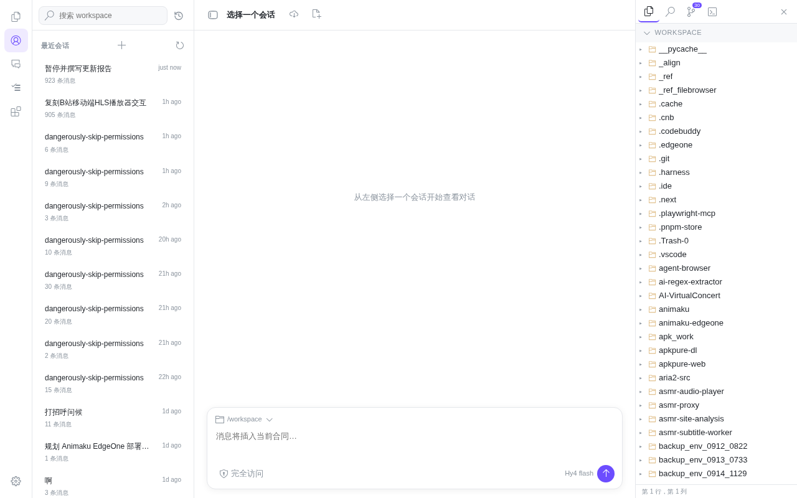
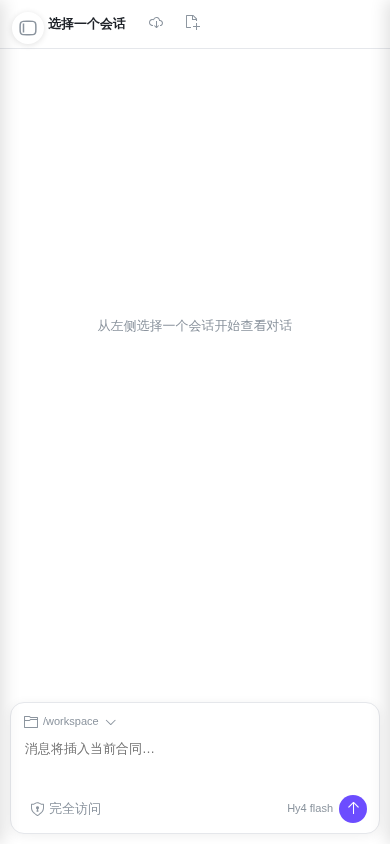
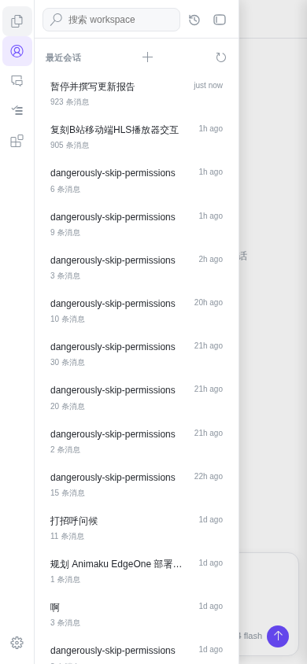
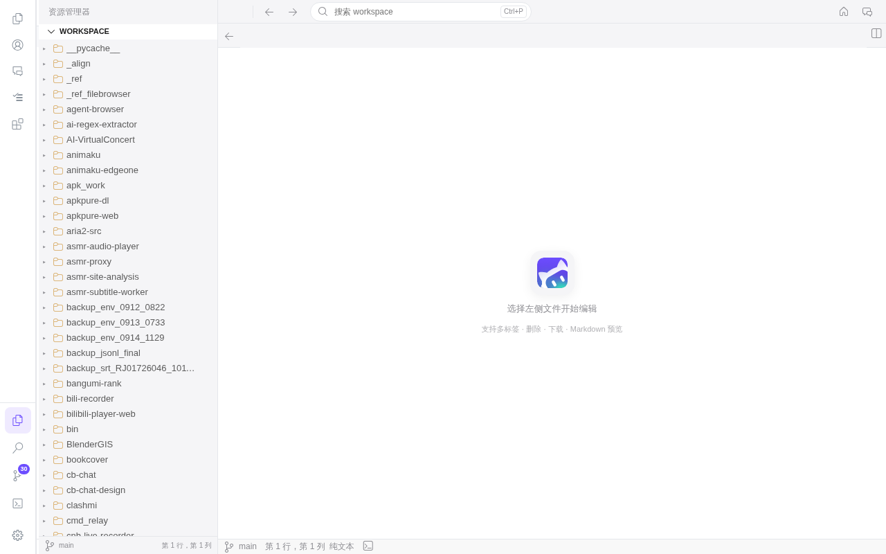
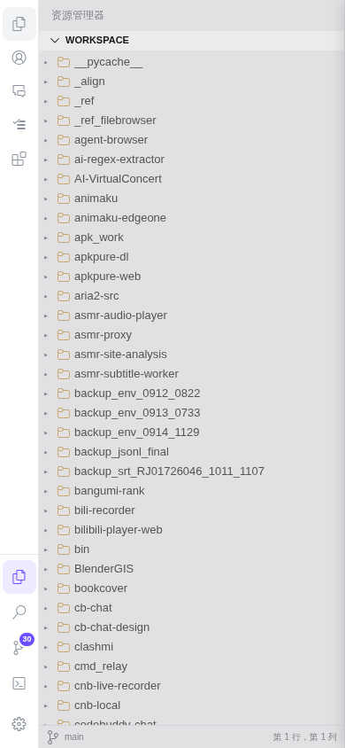
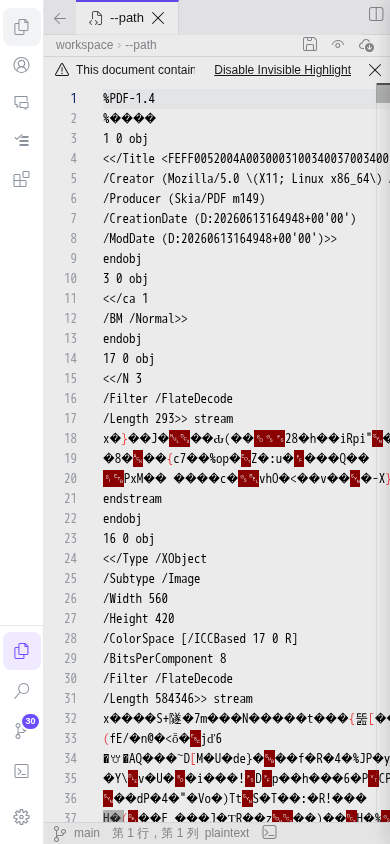

# CodeBuddy Web UI 复刻 — 对话 + 文件管理 + 文件编辑

一个**前端仿 VS Code / CodeBuddy** 的纯前端页面：把终端里的 CodeBuddy 会话搬进浏览器，做成手机友好的对话界面，并配上 VS Code 风格的文件管理器与编辑器。**支持 Markdown 与 HTML 文档预览**。

## 界面预览

| 页面 | 桌面 | 手机 |
|---|---|---|
| 对话页 |  |  |
| 侧栏展开 | — |  |
| 编辑器（文件列表） |  |  |
| 打开文件 | — |  |

## 核心功能

### 对话（CodeBuddy 会话）
- 会话列表：置顶、重命名、删除、搜索；手机端抽屉式侧栏，左上角一键收起/展开
- 对话渲染：用户气泡 / AI 回复 / 思考折叠 / 工具调用聚合（按轮次）
- 新建对话：走真实 `runs` API，SSE 流式回复
- 导出对话为 Markdown

### 文件管理（VS Code 风格）
- 左侧文件树：目录展开、新建文件/文件夹、删除
- 文件搜索（Ctrl+P）、内容搜索（grep）
- 源代码管理变更数角标、终端面板

### 文件编辑
- Monaco 编辑器（语法高亮，多语言）
- 多标签：并行打开多个文件，可拆分
- 编辑保存（Ctrl+S）、脏标签提示、下载文件
- **预览**：Markdown 渲染 + **HTML 渲染（iframe 实时预览）**

### 终端
- 仿 VS Code 终端面板：工具栏、多终端 rail、拆分终端
- 终端协议 → DOM 渲染，支持 TUI 交互（辅助键 Esc/⇧Tab/Enter）

## 设计说明

见 [`文件浏览设计规范.md`](文件浏览设计规范.md)：左侧导航区 + 右侧内容区的通用设计范式，以及桌面/移动端的形态转换。桥接实现细节见 [`README-bridge.md`](README-bridge.md)。

## 本地运行

```bash
bash start.sh 7911      # 启动内置 HTTP 服务，监听 7911
# 打开 http://127.0.0.1:7911/chat
```

纯静态前端资源在 `web/`，无构建步骤。对接 code-server 远端终端的桥接逻辑见 `bridge_hot.js`（需要 code-server 环境）。

## 技术栈

- 前端：原生 HTML / CSS / JavaScript（无框架、无构建）
- 编辑器：Monaco（从 CodeBuddy Web UI 提取的编译产物）
- 图标：codicon / Lucide / Seti 文件图标
- 后端桥接：Node.js（对接 code-server 的 PTY / RPC）
- 字体/图标资源本地化，离线可用

## 验证

`run_all_checks.sh` 提供一键回归（8 个 Playwright 脚本，覆盖对话、编辑器、终端、分栏、文件预览等）。

## 说明

本项目是学习性质的 UI / 交互复刻，用于研究 CodeBuddy Web UI 与 VS Code 终端/编辑器/文件树的实现方式。界面图标字体等资源来自对应官方发行包的本地副本。
